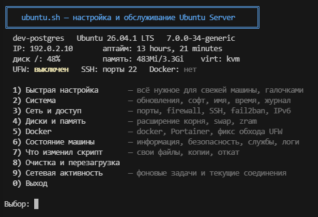

# ubuntu.sh

Интерактивная настройка и обслуживание Ubuntu Server: обновления,
пакеты, SSH, UFW, Docker/Portainer, диски, swap, IPv6 и резервные копии.
Один Bash-файл, русское меню. Дополнительный интерфейс устанавливать не нужно.
Системные пакеты для выбранных действий скрипт устанавливает через apt.



## Где проверено

Ubuntu Server 26.04 в виртуальной машине Proxmox.
Bare-metal и LXC отдельно не проверялись. Рост корневого раздела вживую
проверен только для LVM с ext4; для остальных вариантов скрипт
предупреждает об этом перед подтверждением.

## Запуск

Скачать на сервере последнюю версию из релизов:

```bash
wget https://github.com/Avmbur/ubuntu.sh/releases/latest/download/ubuntu.sh
sudo bash ubuntu.sh
```

Или скопировать с Windows из PowerShell, заменив `user` и `server`:

```powershell
scp .\ubuntu.sh user@server:~/ubuntu.sh
ssh user@server
sudo bash ~/ubuntu.sh
```

Файл должен оставаться в UTF-8 без BOM, с переводами строк LF.

## Меню

| Пункт | Назначение |
| --- | --- |
| 1 | Быстрая настройка: выбор нужных действий |
| 2 | Система: обновления, пакеты, имя, время, журнал |
| 3 | Сеть и доступ: порты, UFW, SSH, fail2ban, IPv6 |
| 4 | Диски и память: расширение корня, swap, zram |
| 5 | Docker и Portainer |
| 6 | Состояние машины и диагностика |
| 7 | Изменённые файлы, резервные копии, восстановление |
| 8 | Очистка и перезагрузка |
| 9 | Фоновые сетевые задачи и текущие соединения |

В пункте 1 изначально ничего не выбрано. Повторный запуск показывает
текущее состояние; изменение требует выбора действия и ответа на вопросы.
Статический IP и второй диск в этот выпуск не входят.

В **9** состояния задач показаны над текущими соединениями TCP/UDP.
Соединения обновляются каждые три секунды; во время ввода обновление
приостанавливается. Короткие обращения между обновлениями могут не попасть
в список; адреса показываются без DNS, содержимое обмена не анализируется.
Включение службы не означает, что она сейчас передаёт данные.

Новости MOTD и apt, данные пакетов, сведения о новом выпуске Ubuntu,
прошивки и Apport управляются отдельно. Ubuntu Pro и периодические задачи
APT здесь доступны только для просмотра (автообновления — **2 → 6**).
Для Snap предусмотрены ночное окно, конечная пауза, возобновление и удаление
только при пустом списке снапов. Отключение cloud-init требует указать,
что это конечная машина: для будущего шаблона оно не предлагается.

## Доступ и firewall

Смена SSH-порта: **3 → 2 → 5**. Новый порт сначала добавляется к старому.
Нужно действительно подключиться из другой вкладки и затем подтвердить вход.
Ответ «нет» восстанавливает исходные файлы и старый слушатель. Если прервать
скрипт на вопросе, два порта могут остаться настроены; текущая сессия сама
по себе не доказывает, что новое подключение работает. Копии перехода лежат
в `/var/backups/ubuntu-sh/ssh-change.*`. Правило нового порта UFW после отмены
сохраняется: удалить его можно через **3 → 1 → 2**.
Нестандартные конфигурации с несколькими исходными Port или неподходящим
KillMode автоматически не переключаются.
После успешного перехода или проверенного отката временный каталог этого
перехода удаляется; обычные резервные копии остаются в пункте 7.
Каталоги от незавершённых и старых переходов автоматически не удаляются.

Смена пароля: **3 → 2 → 6**. Скрипт показывает выбранного локального
пользователя и просит подтверждение (Enter — отказ). Стандартный `passwd`
принимает новый пароль скрыто, дважды, напрямую с терминала. Скрипт не
сохраняет ввод в переменные или лог. Меняется пароль учётной записи Ubuntu,
а не отдельный пароль SSH. Настройки входа по паролю и PermitRootLogin
этот пункт не меняет; вход нужно проверить новым подключением.

Создание пользователя: **3 → 2 → 7**. Создаются локальная учётная запись,
одноимённая группа, `/home/имя` и оболочка Bash; затем скрыто задаётся пароль.
Существующие учётки, группы и домашние каталоги не переиспользуются.
Добавление в sudo — отдельный вопрос с отказом по умолчанию. Если установка
пароля не завершилась, пользователь сохраняется; продолжить можно через
**3 → 2 → 6**. Для входа по ключу используется **3 → 2 → 1**.
Перед вводом имени в пунктах 6 и 7 показываются уже существующие пользователи.

Удаление пользователя: **3 → 2 → d**. Пользователь выбирается по номеру
из списка; после отдельного подтверждения удаляется локальная учётная запись,
а домашний каталог, почта и остальные файлы остаются. root, системные учётки
и пользователь запуска в список не попадают; учётки с работающими процессами
помечены и не удаляются. Принудительная остановка процессов не выполняется.

Перед заменой существующего `jail.local` показываются все непустые строки
настроек по секциям, включая продолжения строк и INCLUDES. Это содержимое
одного файла, не итоговая конфигурация fail2ban: учитываются также jail.conf
и jail.d. Отказ выбран по умолчанию.

Для Docker фильтр настраивается через **5 → 1**. Он рассчитан на Docker
с backend iptables и стандартными bridge-интерфейсами `docker*` / `br-*`.
Docker nftables, host/macvlan/ipvlan/overlay-сети не покрываются этой схемой.
Правила в DOCKER-USER должен вести один инструмент; не добавляйте туда
параллельно собственные правила после настройки фильтра.

**3 → 1 → 1** разрешает внешний порт: для `8080:80` указывается `8080`.
Можно ограничить источник и адрес сервера. «Все адреса» означает все адреса
сервера на этом внешнем порту. Разрешение хранится по исходной точке
назначения соединения, поэтому смена IP контейнера не требует обновлять его.
IPv4 и IPv6 записываются раздельно. Для host proxy также создаётся входящее
правило UFW с теми же ограничениями. Доступ через proxy также зависит от
остальных входящих правил UFW: ранее добавленный широкий ALLOW может
разрешать больше, чем указано в реестре Docker.

Список Docker-разрешений показывается отдельно от номерных правил UFW.
Для полного закрытия контейнерного порта используйте **3 → 1 → 2**:
удаление только входящего правила UFW по номеру не закрывает DNAT-публикацию.
Сброс правил в **3 → 1** возвращает Docker-разрешения из реестра с теми же
источником и адресом сервера. Старые route-правила не заменяют новые
разрешения Docker. После перехода на новую схему явно разрешите необходимые
опубликованные порты.

Наличие сокета, файла конфигурации или ALLOW-строки не доказывает доступность
из сети. Проверяйте соединение с другой машины; внешние firewall, NAT
маршрутизатора и правила Proxmox скрипт не диагностирует.
В **6 → 2** и списке портов Docker отдельно указано наличие разрешения
в реестре скрипта, его источник и адрес сервера. Недоступный или повреждённый
реестр показывается как неизвестное состояние, а не как отсутствие разрешений.

Portainer автоматически обновляется только с томом `portainer_data` в `/data`
и обычным подключением Docker socket. Другой том, bind-mount данных или
дополнительные mounts приводят к отказу до остановки контейнера. Полное
сохранение произвольной сторонней конфигурации контейнера не предусмотрено.

При первой установке скрипт читает из лога контейнера одноразовый токен
и показывает его в сводке и сразу после запуска. Этот токен надо вставить
при создании первой учётки Portainer. Если строка в логе не появилась,
сводка указывает команду `docker logs portainer`. Новый токен после
перезапуска контейнера скрипт не показывает.

## Лог и восстановление

- Команды и сообщения: `/var/log/ubuntu-setup.log`.
- Копии конфигураций: `/var/backups/ubuntu-sh/`, индекс — `.index`.
- Принадлежность файлов: `/var/lib/ubuntu-sh/files`.
- Пакеты: `/var/lib/ubuntu-sh/packages`.
- Docker-разрешения: `/var/lib/ubuntu-sh/docker-ports`.

Повторная запись того же содержимого через `file_write` пропускается.
При отдельном запросе копии сравниваются содержимое, режим, UID и GID
с последней существующей копией того же файла. Совпадение повторно
использует её без новой записи в индексе. Ранее накопленные копии сохраняются.

Файл без записи о создании считается чужим, даже если его создала старая
версия скрипта. Это не мешает сделать копию и изменить выбранную настройку,
но целиком удалить такой файл из пункта 7 нельзя. Восстановление копии
не восстанавливает принадлежность. Изменения дисковых разделов, удаление
пакетов и данные приложений не откатываются восстановлением одного конфига.

## Ссылки

[Docker и исходные адреса после DNAT](https://docs.docker.com/engine/network/firewall-iptables/#match-the-original-ip-and-ports-for-requests),
[конфигурация OpenSSH](https://manpages.ubuntu.com/manpages/resolute/man5/sshd_config.5.html),
[порядок чтения настроек fail2ban](https://github.com/fail2ban/fail2ban/blob/master/man/jail.conf.5).

## Лицензия

MIT, см. [LICENSE](LICENSE).
